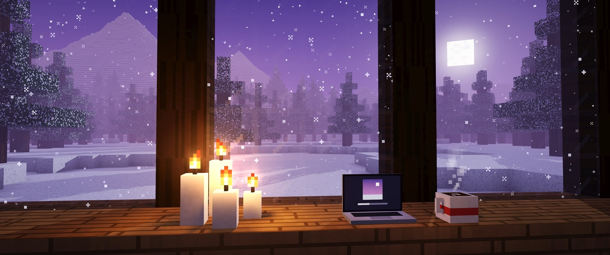
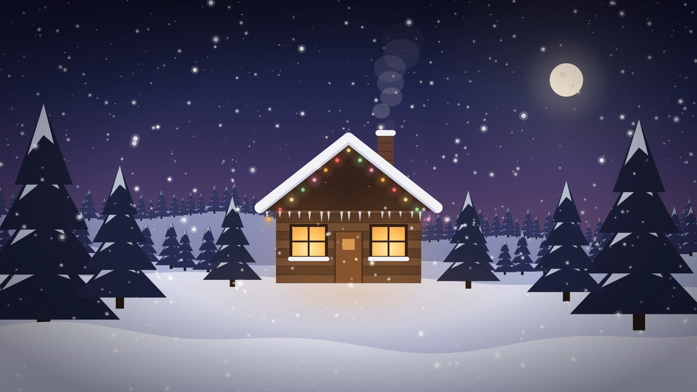

# 움짤배경 (GIF Wallpaper for macOS)

맥 바탕화면에 **움짤(GIF)이나 동영상(MP4)** 을 배경화면으로 재생해 주는 작은 메뉴 막대 앱입니다.
기본 배경화면 두 개(마인크래프트풍 겨울밤, 눈 내리는 오두막)와 그 영상을 만드는 코드도 함께 들어 있어요.



## 기능

- GIF · 움직이는 PNG · WebP · MP4 · MOV 재생 (동영상은 소리 없이 반복)
- 여러 모니터 지원, 바탕화면 아이콘 아래에 표시
- 화면 꽉 채우기 / 전체 보기 전환
- 일시정지, 화면이 꺼지면 자동으로 멈춤
- 마지막으로 고른 파일 기억, 로그인 시 자동 실행
- 독(Dock)에 뜨지 않고 메뉴 막대 🖼 아이콘으로만 동작

## 설치

macOS 13 이상, Xcode 명령줄 도구(`xcode-select --install`)가 필요합니다.

```bash
git clone https://github.com/SongYongGyu4006/gif-wallpaper.git
cd gif-wallpaper
./build.sh
open 움짤배경.app
```

`움짤배경.app` 을 **응용 프로그램** 폴더로 옮겨 두면 "로그인 시 자동 실행"도 쓸 수 있어요.
완성된 앱과 영상은 [Releases](https://github.com/SongYongGyu4006/gif-wallpaper/releases)에서도 받을 수 있습니다.
(서명되지 않은 앱이라 처음 열 때는 오른쪽 클릭 → **열기** 를 눌러 주세요.)

## 사용법

메뉴 막대의 🖼 아이콘 → **움짤 선택…** 에서 파일을 고르면 끝입니다.

## 기본 배경화면 만들기

영상 파일은 저장소에 넣지 않고, 코드로 직접 만들 수 있게 해 두었습니다.

### 마인크래프트풍 겨울밤 (`tools/MinecraftWinter.swift`)

창밖으로 눈 덮인 산과 가문비나무, 내리는 눈. 방 안에는 일렁이는 촛불, 노트북, 김이 모락모락 나는 코코아.
블록 세계를 복셀 레이트레이싱으로 한 번 렌더링하고, 촛불 · 불꽃 · 눈 · 김을 매 프레임 합성합니다.
3440×1440, 30fps, 12초 끊김 없는 반복(HEVC).

```bash
swiftc -Ounchecked -o mcwinter tools/MinecraftWinter.swift
./mcwinter 마크겨울.mp4
```

미리보기 이미지만 빠르게 보려면: `./mcwinter - preview.png 0.4` (마지막 숫자는 해상도 배율)

### 눈 내리는 오두막 (`tools/WinterScene.swift`)



```bash
swiftc -O -o winter tools/WinterScene.swift
./winter 따뜻한겨울.mp4
```

## 파일 구성

| 파일 | 설명 |
| --- | --- |
| `GifWallpaper.swift` | 배경화면 앱 |
| `build.sh` | 앱(`움짤배경.app`) 빌드 스크립트 |
| `tools/MinecraftWinter.swift` | 마인크래프트풍 겨울밤 영상 생성기 |
| `tools/WinterScene.swift` | 오두막 겨울밤 영상 생성기 |

## 라이선스

[MIT](LICENSE)

이 프로젝트는 Mojang/Microsoft와 관계없는 팬 메이드 작품이며, 장면은 모두 코드로 직접 그린 것입니다.
"Minecraft"는 Mojang Synergies AB의 상표입니다.
